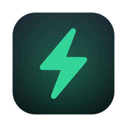
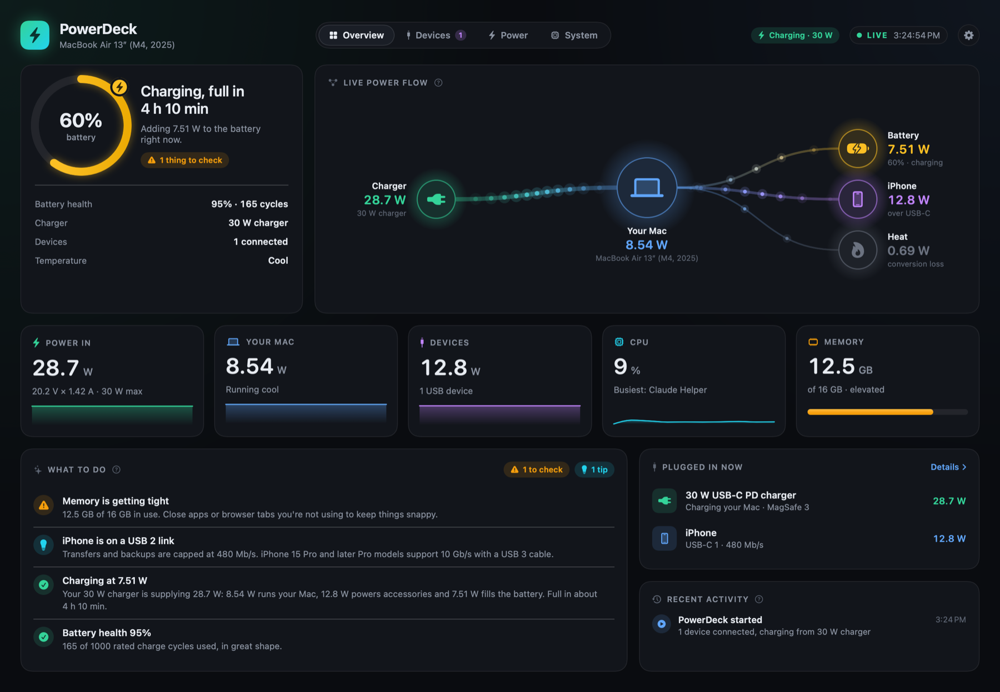
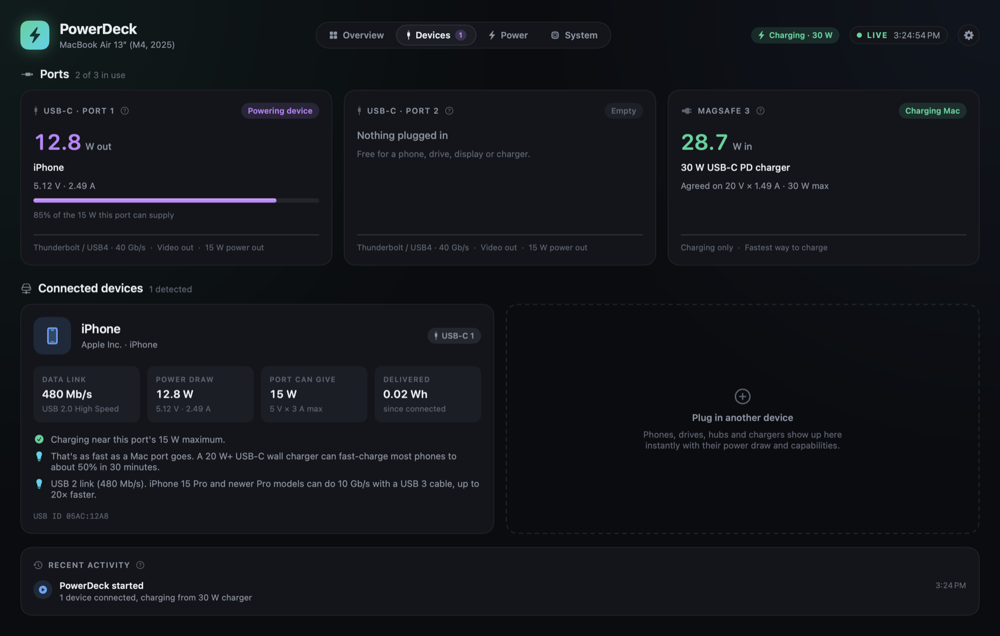
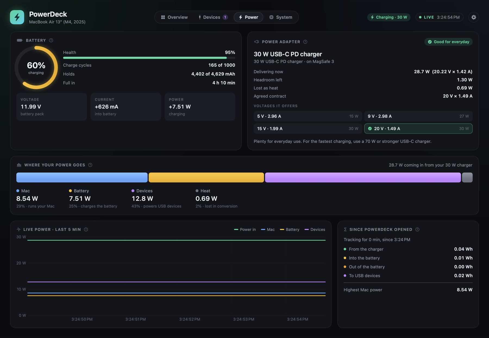
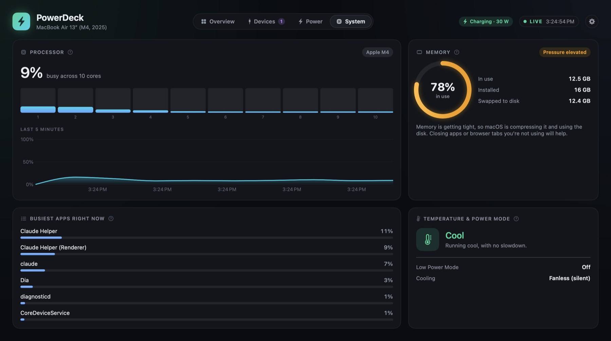
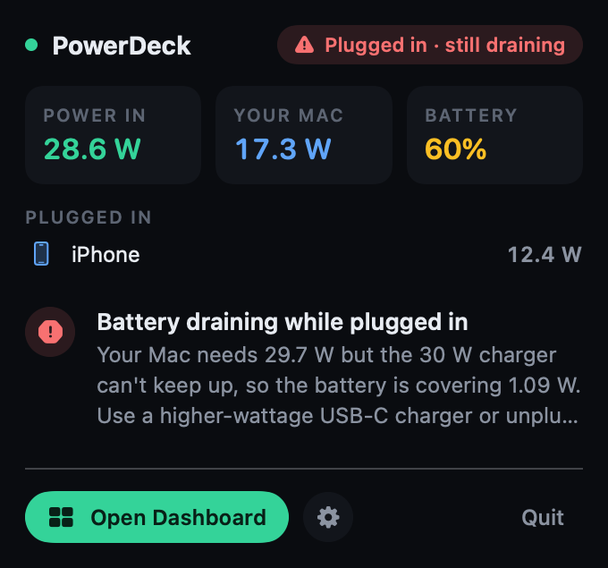
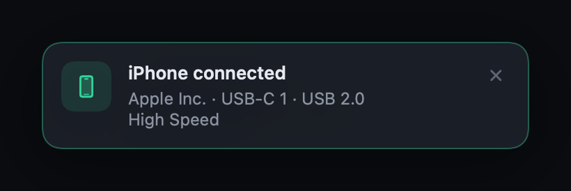

<p align="center">
  
</p>

<h1 align="center">PowerDeck</h1>

<p align="center">
  <b>See where your Mac's power goes, live.</b><br>
  Your charger, battery and everything you plug in, in one simple dashboard.
</p>

<p align="center">
  
  
  
</p>

<p align="center">
  
</p>

## What it does

- **Live power flow:** watch power move from your charger into your Mac, its battery and your devices.
- **Plugged-in devices:** see what's in each port, how fast it's charging and how fast it can transfer data.
- **Charger check:** find out if your charger is strong enough for your Mac.
- **Battery health:** charge, health and cycle count at a glance.
- **Simple advice:** tips in plain English, like when your phone is draining your Mac's battery.
- **Menu bar and alerts:** live wattage in the menu bar, and a heads-up when you plug something in.

## Screenshots

<table>
  <tr>
    <td width="50%"></td>
    <td width="50%"></td>
  </tr>
  <tr>
    <td align="center"><b>Devices</b></td>
    <td align="center"><b>Power</b></td>
  </tr>
  <tr>
    <td width="50%"></td>
    <td width="50%" align="center">
      <br><br>
      
    </td>
  </tr>
  <tr>
    <td align="center"><b>System</b></td>
    <td align="center"><b>Menu bar and alerts</b></td>
  </tr>
</table>

## Install

You need macOS 15 or later and Xcode (or just run `xcode-select --install`).

```bash
git clone https://github.com/avi20009/PowerDeck.git
cd PowerDeck
scripts/build.sh --open
```

PowerDeck opens when the build finishes. To keep it, drag `build/PowerDeck.app` into your **Applications** folder.

## How to use

- Switch between **Overview**, **Devices**, **Power** and **System** with the tabs at the top (or ⌘1 to ⌘4).
- Click **⚡** in the menu bar for a quick look.
- Hover the **?** on any card to see what it means.
- Press **⌘,** for Settings: menu bar display, refresh rate and alerts.

Works best on MacBooks with Apple silicon (M1 or later).

---

<p align="center">
  Made by <b>Avi Barvaliya</b> (<a href="https://github.com/avi20009">@avi20009</a>) · <a href="LICENSE">MIT license</a> · <a href="docs/how-it-works.md">How it works</a>
</p>
