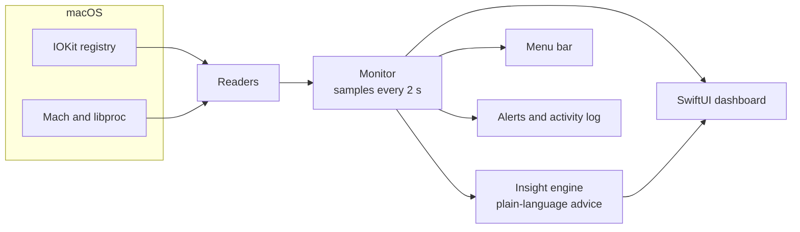

<p align="center">
  
</p>

<h1 align="center">PowerDeck</h1>

<p align="center">
  <b>A native macOS dashboard that shows where your Mac's power goes, live.</b><br>
  Your charger, your battery, every USB-C port, everything you plug in, and plain-English advice on what to do about it.
</p>

<p align="center">
  
  
  
  
  
</p>

<p align="center">
  
</p>

---

## Why

Plug your phone into a MacBook and macOS tells you almost nothing. Is it actually charging? How fast? Is your charger strong enough for your Mac **and** your phone? Is that cable only running at USB 2 speed?

Your Mac measures all of this; it just doesn't show it. PowerDeck reads those measurements straight from macOS and turns them into a dashboard anyone can understand.

## Features

**See it**
- **Live power flow:** an animated diagram of power moving from your charger (or battery) into your Mac and out to its battery, your devices and conversion heat. Particles move faster as more watts flow.
- **Every port:** what each USB-C and MagSafe port is doing right now: charging the Mac, powering a device (with exact volts, amps and watts), or carrying data.
- **Every device:** phones, drives, hubs and accessories are identified, mapped to the exact port they're in, and given a capability verdict: data speed, how fast they're charging and what the port can supply.
- **Your charger:** brand and model, the voltage your Mac agreed on, every power level the charger offers, and whether it's strong enough for your Mac.
- **Battery health:** charge, health, cycle count, capacity, and live voltage and current.
- **System:** CPU per core with a 5-minute history, memory and memory pressure, busiest apps and temperature.

**Understand it**
- **"What to do":** plain-language advice ranked by urgency, for example *"Your iPhone is drawing 13 W, more than your Mac itself. Unplugging would stretch your battery from 1 h 7 min to 2 h 22 min."*
- **Alerts** when a device or charger is plugged in or unplugged, or a new problem appears, with optional Notification Center alerts.
- **Activity log** and **energy totals** for the session, including how many watt-hours each device received.
- `?` tooltips on every section explain the jargon.

**Live with it**
- A **menu bar readout** with a quick-look panel.
- **Settings** for what the menu bar shows, the refresh rate, Dock icon and opening at login.
- No admin password, helper tool, network access or tracking.

## Screenshots

<table>
  <tr>
    <td width="50%"></td>
    <td width="50%"></td>
  </tr>
  <tr>
    <td align="center"><b>Devices</b>: what's plugged into each port and what it can do</td>
    <td align="center"><b>Power</b>: battery, charger verdict, power split and live chart</td>
  </tr>
  <tr>
    <td width="50%"></td>
    <td width="50%" align="center">
      <br><br>
      
    </td>
  </tr>
  <tr>
    <td align="center"><b>System</b>: CPU, memory, busiest apps, temperature</td>
    <td align="center"><b>Menu bar panel</b> and a <b>plug-in alert</b></td>
  </tr>
</table>

## Install

### Requirements

- macOS 15 Sequoia or later
- A MacBook with Apple silicon (M1 or later). Other Macs run it, but show less power detail.
- Xcode 16 or later, or the Swift 6 toolchain (`xcode-select --install`)

### Build and run

```bash
git clone https://github.com/avi20009/PowerDeck.git
cd PowerDeck
scripts/build.sh --open
```

The script compiles a release build, generates the app icon, packages `build/PowerDeck.app`, signs it for your Mac and opens it. To keep it, drag `build/PowerDeck.app` into your **Applications** folder.

No Xcode project is needed: it's a plain Swift package.

## How to use

| | |
|---|---|
| **Overview** `⌘1` | One-glance status, the live power flow and what needs attention |
| **Devices** `⌘2` | Every port and every connected device |
| **Power** `⌘3` | Battery, charger, power split and session energy |
| **System** `⌘4` | CPU, memory, busiest apps and temperature |
| **Menu bar ⚡** | Live wattage or battery %. Click it for a quick-look panel |
| **Settings** `⌘,` | Menu bar style, refresh rate (1, 2 or 5 s), alerts, Dock icon, open at login |

Hover the `?` next to any card title for an explanation of what it shows.

## How it works

PowerDeck reads data macOS already publishes, through public IOKit and Mach APIs:

| What you see | Where it comes from |
|---|---|
| Charger wattage, negotiated voltage, supported power levels | `AppleSmartBattery` → `AdapterDetails` |
| Power in, the Mac's own load, conversion loss | `AppleSmartBattery` → `PowerTelemetryData` |
| Power sent out of each USB-C port | `AppleSmartBattery` → `PowerOutDetails` |
| Battery charge, health, cycles, voltage, current | `AppleSmartBattery` |
| Ports, what's attached, charger maker and model | `AppleHPMInterface`, `IOPortFeaturePowerSource`, USB Power Delivery partner info |
| USB devices and the physical port each one is in | `IOUSBHostDevice`, walking up to the controller port's `UsbIOPort` |
| CPU, memory, busiest apps | `host_processor_info`, `host_statistics64`, `proc_pid_rusage` |



### Built to stay light

A monitor that slows your Mac down defeats the point, so PowerDeck was profiled as it was built. A few common SwiftUI techniques turned out to be expensive for a window that updates every two seconds:

| Technique | Measured cost | What PowerDeck does instead |
|---|---|---|
| Repeating SwiftUI animations and drop shadows on cards | ~20–30% CPU | Continuous effects (flow particles, "live" pulses) are Core Animation layers that the system animates on its own; cards have no shadows |
| Rolling-digit `.numericText()` transitions | ~10% CPU | A 0.25 s cross-fade on headline numbers only (~1%) |
| Asking AppKit to size embedded views | Extra layout work on every frame | Fixed sizes for the Core Animation views |

Reading the hardware itself is cheap: a full sample of every sensor takes a few milliseconds.

## Limitations

- **iPhone model:** over USB an iPhone identifies itself only as "iPhone", so PowerDeck can't tell a 15 Pro from a 13, and its USB-speed tips say so.
- **Hubs:** power is measured per port, so devices behind one hub share a single reading.
- **Settling time:** right after you plug in or unplug a charger, macOS takes up to a minute to re-measure. PowerDeck shows "starting up" or "measuring" until it has real numbers.
- **Code signing:** the build script signs the app for your own Mac only. It isn't notarized for distribution.

## Command-line tools

The same binary has two developer modes:

```bash
swift build -c release
.build/release/PowerDeck --dump                  # print every reading, insight and event
.build/release/PowerDeck --snapshot screenshots  # render every tab to PNG files
```

`--snapshot` is how the screenshots in this README were made.

## Project structure

```
PowerDeck/
├── Package.swift
├── Resources/Info.plist
├── scripts/
│   ├── build.sh               # build, package, sign and open the app
│   └── make_icon.swift        # draws the app icon
└── Sources/PowerDeck/
    ├── App/                   # app entry point, scenes, --dump and --snapshot
    ├── Core/                  # hardware readers, Monitor, insight engine, models
    └── UI/                    # tabs, cards, flow diagram, menu bar panel, settings
```

## Roadmap

- [ ] Notarized download on the Releases page
- [ ] Charge history per device over days, not just per session
- [ ] Desktop and Notification Center widgets
- [ ] Light mode

## Author

Made by **Avi Barvaliya** ([@avi20009](https://github.com/avi20009)). Issues and ideas are welcome.

## License

[MIT](LICENSE)
