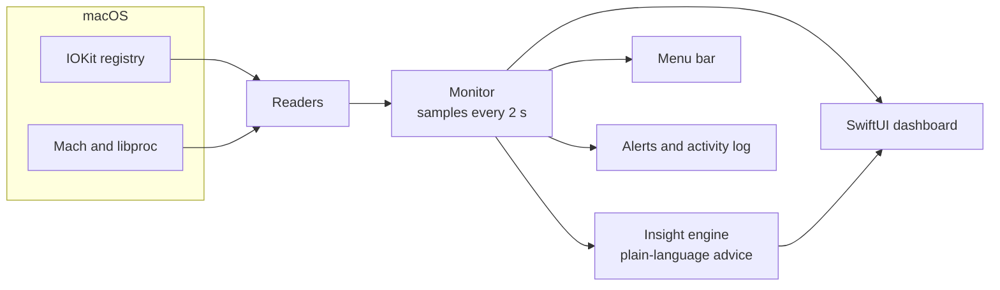

# How PowerDeck works

For the curious: where the numbers come from, how the app stays light, and what it can't do. To just use the app, see the [README](../README.md).

## Where the data comes from

PowerDeck reads data macOS already publishes, through public IOKit and Mach APIs:

| What you see | Where it comes from |
|---|---|
| Charger wattage, negotiated voltage, supported power levels | `AppleSmartBattery` → `AdapterDetails` |
| Power in, the Mac's own load, conversion loss | `AppleSmartBattery` → `PowerTelemetryData` |
| Power sent out of each USB-C port | `AppleSmartBattery` → `PowerOutDetails` |
| Battery charge, health, cycles, voltage, current | `AppleSmartBattery` |
| Ports, what's attached, charger maker and model | `AppleHPMInterface`, `IOPortFeaturePowerSource`, USB Power Delivery partner info |
| USB devices and the physical port each one is in | `IOUSBHostDevice`, walking up to the controller port's `UsbIOPort` |
| CPU, memory, busiest apps | `host_processor_info`, `host_statistics64`, `proc_pid_rusage` |



## Built to stay light

A monitor that slows your Mac down defeats the point, so PowerDeck was profiled as it was built. A few common SwiftUI techniques turned out to be expensive for a window that updates every two seconds:

| Technique | Measured cost | What PowerDeck does instead |
|---|---|---|
| Repeating SwiftUI animations and drop shadows on cards | ~20–30% CPU | Continuous effects (flow particles, "live" pulses) are Core Animation layers that the system animates on its own; cards have no shadows |
| Rolling-digit `.numericText()` transitions | ~10% CPU | A 0.25 s cross-fade on headline numbers only (~1%) |
| Asking AppKit to size embedded views | Extra layout work on every frame | Fixed sizes for the Core Animation views |

Reading the hardware itself is cheap: a full sample of every sensor takes a few milliseconds.

## Limitations

- **iPhone model:** over USB an iPhone identifies itself only as "iPhone", so PowerDeck can't tell a 15 Pro from a 13, and its USB-speed tips say so.
- **Hubs:** power is measured per port, so devices behind one hub share a single reading.
- **Settling time:** right after you plug in or unplug a charger, macOS takes up to a minute to re-measure. PowerDeck shows "starting up" or "measuring" until it has real numbers.
- **Code signing:** the build script signs the app for your own Mac only. It isn't notarized for distribution.

## Command-line tools

The same binary has two developer modes:

```bash
swift build -c release
.build/release/PowerDeck --dump                  # print every reading, insight and event
.build/release/PowerDeck --snapshot screenshots  # render every tab to PNG files
```

`--snapshot` is how the screenshots in the README were made.

## Project structure

```
PowerDeck/
├── Package.swift
├── Resources/Info.plist
├── scripts/
│   ├── build.sh               # build, package, sign and open the app
│   └── make_icon.swift        # draws the app icon
└── Sources/PowerDeck/
    ├── App/                   # app entry point, scenes, --dump and --snapshot
    ├── Core/                  # hardware readers, Monitor, insight engine, models
    └── UI/                    # tabs, cards, flow diagram, menu bar panel, settings
```

## Roadmap

- [ ] Notarized download on the Releases page
- [ ] Charge history per device over days, not just per session
- [ ] Desktop and Notification Center widgets
- [ ] Light mode
